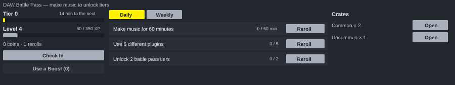

# DAW Battle Pass for Ableton Live

A Max for Live MIDI effect. The game is `reascripts/bp_game.lua`, `bp_loot.lua` and `bp_theory.lua`, the same files the REAPER script runs, unchanged; what it watches is the Live set.

## Installing

Needs **Live 12.1 or later with Max for Live** (Live Suite, or Standard with
the add-on): the device runs on Max 9's JavaScript engine (`[v8ui]`).

1. Copy `DAW Battle Pass.amxd`, `DAWBattlePass.js` and `DAWBattlePass.maxpat` into one folder, for
   example `Music/Ableton/User Library/Presets/MIDI Effects/Max MIDI Effect/`. The `.amxd` finds
   `DAWBattlePass.js` beside it.
2. Drag `DAW Battle Pass.amxd` onto any MIDI track (it passes MIDI straight through).
3. Optional: open it in the Max editor and click **Freeze Device**, then save.
   The device then carries the script inside it and can be moved on its own.

## Using it

| | |
| --- | --- |
| **Tier, Level** | Every fifteen minutes of making music unlocks a tier; everything you do earns XP, and every level a crate. Time counts while something in the set changes or Live is playing or recording. |
| **Check In** | Once a day, for the check-in calendar's reward. |
| **Quests** | Daily and weekly. **Claim** a finished one; **Reroll** one you do not want, while you have rerolls. |
| **Crates** | Open them here. |
| **What counts** | New tracks, clips, devices (by name, so a quest for a plug-in can be met), notes added to the clip in Detail View, locators, and clips recorded while recording. |

The game is the musician's, not the set's: it is saved in `DAW Battle Pass save.txt` beside the device every thirty seconds, and with the set; the one with more time in it is used.

## How it is built

`ableton/device.json` describes the device; `python3 ableton/kit/build.py
ableton/device.json` writes the `.amxd`, the `.maxpat` and the script bundle
`DAWBattlePass.js`. The bundle is Middaw's Lua 5.4 runtime, the three game files, Middaw's host (its `passStart`, `passCall`, `passGet` and `passNotices`, as Middaw's own Battle Pass window uses them), and `ableton/battlepass.js`: the panel, and the watch on the Live set. See `ableton/kit/VENDORED.md`.

`node --test ableton/tests/test_device.js` runs the device on a pretend Max and Live: the game starts and shows its quests, time playing fills the tier, a new track, clip and device become events, Check In pays once, a finished quest is claimed and a level's crate opened, and the game is kept in a file and comes back in another set.

## Limits

- **It has not been opened in Live yet.** It is tested in Node against a stand-in for Max and the Live Object Model; nothing has run in Max. If the `.amxd` will not open, open `DAWBattlePass.maxpat` in Max and save it as a device.
- The shop, gear, stats and ideas from the REAPER window are not on the device yet: the game keeps them, and they come back in REAPER or Middaw from the same save.
- Live gives a device no mouse or keyboard activity, so time counts while the set changes or plays: thinking for a long while without touching anything stops the clock sooner than in REAPER.
